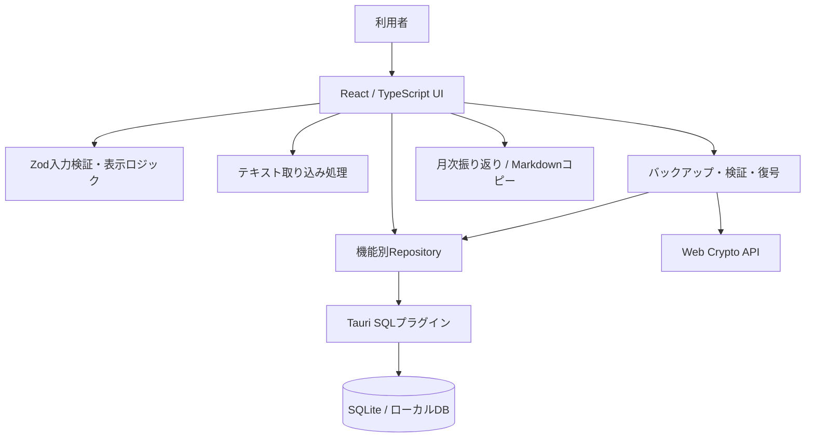

# アーキテクチャ

## 1. システムの位置づけ

本アプリはWindows向けのローカルファーストなデスクトップアプリである。画面をReact/TypeScriptで構築し、Tauri v2を介して端末内のSQLiteを操作する。リモートサーバー、ユーザー認証、クラウドDBを中核機能の前提としない設計である。

## 2. 構成概略

これは主要処理を簡略化した**論理構成図**であり、個々の関数呼び出しの完全な追跡図ではない。

## 3. コードの責務

| ディレクトリ・ファイル    | 主な責務                                           |
| ------------------------- | -------------------------------------------------- |
| `src/App.tsx`             | アプリの画面構成・ルーティング・初期化に関わる処理 |
| `src/features/knowledge/` | ナレッジの画面、検証、Repository                   |
| `src/features/inquiry/`   | 問い合わせメモと関連ナレッジの画面・Repository     |
| `src/features/taxonomy/`  | 分類・タグ管理                                     |
| `src/features/review/`    | 月次振り返り                                       |
| `src/features/dashboard/` | ダッシュボードの集計・表示                         |
| `src/features/favorites/` | お気に入りの一覧                                   |
| `src/features/settings/`  | バックアップ・復元と暗号処理                       |
| `src/lib/db/`             | SQLite接続とスキーマ・マイグレーション             |
| `src/lib/utils/`          | 日付・テキスト取り込み・入力補助などの共通処理     |
| `src-tauri/`              | Tauri、Rust、アプリの権限・バンドル設定            |

## 4. 主要な処理フロー

### 記録の保存

1. 利用者がナレッジまたは問い合わせメモの画面に入力する。
2. 入力値をZodで検証する。
3. Repositoryが保存処理を担当し、SQLプラグイン経由でSQLiteを更新する。
4. 一覧・詳細画面から保存した記録を参照する。

### テキスト取り込み

1. `.txt` / `.md` ファイルを選択する。
2. テキスト解析で取り込み候補を作る。`##` 見出しを使った分割にも対応する。
3. 候補を作成画面へ表示し、内容を確認・修正する。
4. 通常の保存処理へ進む。ファイルの選択だけではDBへ直接保存しない。

### バックアップ・復元

1. SQLite内の対象データをJSONバックアップとして書き出す。
2. 暗号化を選んだ場合、パスワードからPBKDF2で鍵を導出し、AES-GCMで暗号化する。
3. 復元時はJSONの形式・アプリ識別子・テーブルや行データを検証する。
4. 現データとバックアップの件数を比較し、確認を経て復元する。

**設計上の制約**：復元の一連のDB操作を完全な単一トランザクションとして扱っていない。途中失敗時の原状回復は保証できず、事前バックアップが必要となる。

## 5. 設計判断とトレードオフ

- **Tauri + SQLite**：個人のPCでオフラインに近い形で扱いやすい。一方、端末故障や複数PC同期は自動的に解決しない。
- **RepositoryによるDB操作分離**：画面からSQLを切り離して修正箇所を把握しやすくする。一方、復元処理など横断的な操作は依然として複雑になりやすい。
- **バックアップをJSONとして扱う**：構造検証や内容の移行がしやすい。一方、通常JSONは平文であり、復元失敗時のロールバック保証とは別問題である。
- **MVPとしての範囲制限**：認証、クラウド同期、同時編集は実装しない。対象を絞ってCRUD、検索、関連付け、保全を優先する。

## 6. 参照先

- スキーマ定義：`src/lib/db/schema.ts`
- DB初期化・移行：`src/lib/db/migrate.ts`
- 各機能の`*Repository.ts`
- バックアップ検証：`src/features/settings/backupRepository.ts`
- 暗号化処理：`src/features/settings/backupCrypto.ts`
