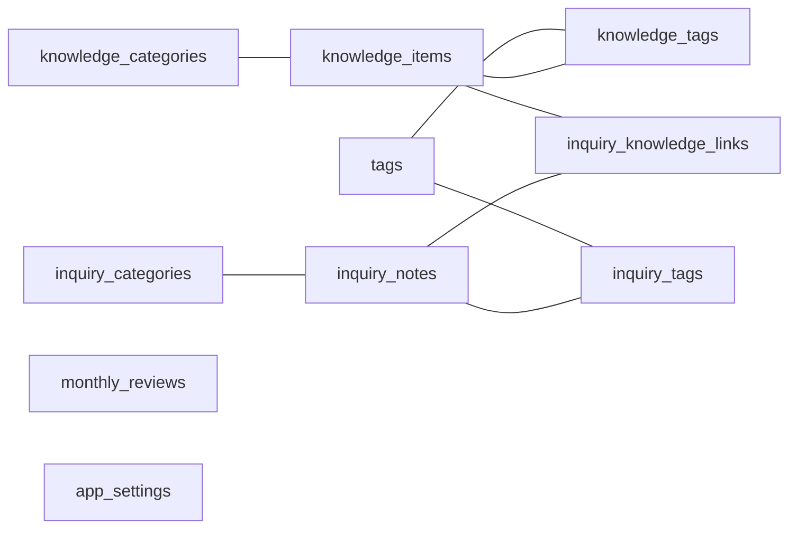

# データベース設計（論理構成）

## 1. 概要

アプリの記録は端末内のSQLiteに保存する。ナレッジ、問い合わせメモ、分類、タグ、関連付け、月次振り返りを分離して管理し、タグなど共通の情報は中間テーブルで紐付ける。

> この文書は**テーブルの役割と論理的な関連**を示す。型、NOT NULL、UNIQUE、外部キーの宣言、インデックス、CASCADE動作などの正確な定義は `src/lib/db/schema.ts` および `src/lib/db/migrate.ts` を参照すること。

## 2. 主なテーブル

| テーブル                  | 主な用途                                                                         |
| ------------------------- | -------------------------------------------------------------------------------- |
| `knowledge_items`         | ナレッジの本体。タイトル・本文・種類・情報元・お気に入りなどを管理               |
| `inquiry_notes`           | 問い合わせメモの本体。問い合わせ概要・対応メモ・次に活かすこと・発生日などを管理 |
| `knowledge_categories`    | ナレッジ用の分類                                                                 |
| `inquiry_categories`      | 問い合わせメモ用の分類                                                           |
| `tags`                    | 共通タグ                                                                         |
| `knowledge_tags`          | ナレッジとタグの関連                                                             |
| `inquiry_tags`            | 問い合わせメモとタグの関連                                                       |
| `inquiry_knowledge_links` | 問い合わせメモとナレッジの関連                                                   |
| `monthly_reviews`         | 対象月ごとの振り返り内容                                                         |
| `app_settings`            | アプリ内設定情報                                                                 |

これら10テーブルはバックアップJSONの検証対象としても扱われる。

## 3. 論理的な関係

図の線はデータの関連を示し、DBにおける外部キー制約の有無・削除時の動作を保証するものではない。

## 4. 設計上の意図

- ナレッジと問い合わせメモを分離し、入力項目と閲覧の目的を混同しない。
- 共通タグは両方の記録へ適用できるよう、タグ本体と紐付けを分離する。
- 問い合わせメモに対して関連ナレッジを複数持たせられる構造を採用する。
- 月次振り返りを日々の記録とは別に保存し、継続的な学びや課題を残せるようにする。
- バックアップは分類や関連データも含めて扱い、復元前の形式検証と件数確認を行う。

## 5. データ整合性に関する注意

- 画面とRepositoryの入力検証だけで、DBの全制約や復元時の整合性が保証されるわけではない。
- 復元処理は一連の操作を単一トランザクションとして完結させていない。途中失敗時の扱いは追加設計の余地がある。
- 具体的なSQL文やインデックスの設計をレビューする場合は、最新の`schema.ts`・`migrate.ts`・Repository実装の確認が必要である。
